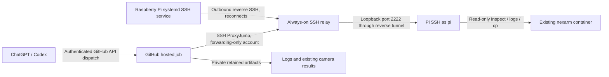

# Unattended operation with the laptop offline

The recommended architecture is a small **Ubuntu 24.04 VPS with a stable public
hostname/IP**, used only as an SSH relay, plus GitHub-hosted Actions jobs for
operator commands. A small general-purpose VPS (for example Hetzner Cloud) is
sufficient; choose an account/provider you control. No Windows laptop, Pi-hosted
GitHub runner, public Docker API, or public Pi SSH port is needed after bootstrap.
No VPS has been selected or provisioned, and nothing has been activated on the Pi.



The Pi maintains the long-lived connection. The Actions job opens an ephemeral
SSH connection through the relay with the existing CLI's tunnel support; it
needs no second long-lived forwarding process. End-to-end SSH authenticates the
real Pi independently of the relay. The Pi protection marker blocks deployment,
rollback, and new camera capture. The existing container remains untouched.

## Implemented files

- `deploy/tunnel/nexarm-tunnel.service`: non-root Pi SSH client, boot startup,
  keepalives, unlimited reconnect attempts every 15 seconds, journal diagnostics.
- `tools/render_tunnel.py`: renders endpoint-specific Pi, relay and runner files;
  contains no secrets and refuses an existing output directory.
- `deploy/install-pi-tunnel.sh`: explicit Pi-host installation only; checks keys,
  refuses changed existing config files, runs preservation bootstrap, installs
  and enables only the outbound SSH service. Never runs Docker exec/stop/run.
- `.github/workflows/robot-readonly.yml`: manual/API dispatch for `probe`,
  `discover-existing`, or `collect-existing`, with optional explicit result paths;
  retains artifacts for seven days, including available failure diagnostics.
- `tools/prepare_actions_access.py`: ephemeral mode-600 SSH credential files,
  pinned host keys, separate relay/Pi identities, cleaned by the workflow.
- CLI `--ssh-config`: isolates job SSH settings from global operator settings.

A running SSH process is not proof of end-to-end readiness. Activate and verify
the complete route with a successful remote `probe` and a collection archive.

## One-time setup, after a relay is selected

A trusted operator needs one initial admin session to the relay and one initial
LAN SSH session to `pi@192.168.100.153`. The laptop can go offline afterwards.
Do not run deployment, change container labels or remove the protection guard.

### 1. Render the public configuration

On a trusted machine with this repository and Python 3:

```sh
python3 tools/render_tunnel.py --relay-host YOUR_RELAY_HOST \
  --relay-port 22 --reverse-port 2222 --output-dir artifacts/tunnel-config
```

Replace YOUR_RELAY_HOST with the chosen server. The public relay SSH port must
be reachable from both the Pi and GitHub runners. Leave reverse port 2222 closed
in the VPS firewall: only the public SSH listener is exposed. A relay SSH listener
on another port can be selected via `--relay-port`; it is still SSH, not HTTPS.
The relay's SSH server policy must permit the two narrowly scoped forwarding
roles below. Keep provider console access while configuring relay SSH.

### 2. Provision three independent identities and verified host keys

On the **Pi**, as `pi`, create a new relay-only key if the destination is unused:

```sh
umask 077
mkdir -p /home/pi/.ssh/nexarm
# Do not overwrite a pre-existing key. This key authenticates only to the relay.
ssh-keygen -t ed25519 -N '' -f /home/pi/.ssh/nexarm/relay_ed25519 -C nexarm-pi-relay
```

An unencrypted, mode-600 key is needed for boot without a human SSH agent. Its
relay account cannot obtain a shell and can only expose the designated loopback
forward. The key remains on the Pi. Enroll only its **public** key on the relay.

Create two separate unencrypted Ed25519 automation keys on a trusted provisioning
machine using new filenames: `operator_relay_ed25519` and `pi_operator_ed25519`.
The first authenticates Actions to the relay's operator-forwarding account. The
second authenticates Actions to the Pi as `pi`. Store their private files only
in the GitHub environment secrets described below; never in Git or chat. Append
the Pi-operator public key to `pi`'s existing `~/.ssh/authorized_keys` with a
`restrict` prefix; preserve all existing keys. That disables PTY/agent/port
forwarding on this identity while allowing the CLI's noninteractive commands.
This identity has pi's Docker permissions; the trusted workflow and preservation
guard are application safeguards, not a sandbox against a malicious SSH operator.

Obtain the relay and Pi Ed25519 **public host keys** and SHA256 fingerprints via
the relay provider console and existing trusted Pi session/console. Verify them
independently. `ssh-keyscan` by itself is not verification.

On the Pi, create `/home/pi/.ssh/nexarm/relay_known_hosts` owned by pi, mode 600,
containing this line with the verified relay public key:

```text
nexarm-relay-infra ssh-ed25519 VERIFIED_RELAY_BASE64_PUBLIC_KEY
```

Only this alias is trusted by the dedicated Pi service. The verified Pi public
host key is enrolled separately into the Actions variables below. Never copy any
`ssh_host_*_key` private host key.

### 3. Configure the dedicated relay forwarding roles

On the relay, have its administrator create normal dedicated Unix accounts
`nexarm-pi-tunnel` and `nexarm-operator-tunnel`, permitted to authenticate with
public keys under the relay's existing account policy. They need no sudo or Docker
access. Use normal home directories with mode-700 `.ssh` and mode-600
`authorized_keys`, owned by the corresponding account.

For the Pi public relay key, prefix its complete public-key line with the options
from `relay/pi_authorized_key.options`. For the operator relay public key, use
`relay/operator_authorized_key.options`. These files hold options only, not keys.
Install rendered `relay/60-nexarm-tunnel.conf` as a new scoped SSH include on the
relay, preserving existing administration configuration. The policy disables
shell sessions, PTY, agent and Unix-socket forwarding; it allows only reverse
forwarding for the Pi role and only the designated destination for the job role.
It explicitly keeps GatewayPorts disabled.

Before reloading the relay's SSH service, validate both syntax and effective policy:

```sh
sudo sshd -t
sudo sshd -T -C user=nexarm-pi-tunnel,host=YOUR_RELAY_HOST,addr=192.0.2.1
sudo sshd -T -C user=nexarm-operator-tunnel,host=YOUR_RELAY_HOST,addr=192.0.2.1
# Debian/Ubuntu service name; reload only after successful verification:
sudo systemctl reload ssh
```

Effective Pi policy must show `allowtcpforwarding remote`,
`permitlisten 127.0.0.1:2222`, `permitopen none`, `gatewayports no`, and
`maxsessions 0`. Operator policy must show `allowtcpforwarding local`,
`permitopen 127.0.0.1:2222`, `permitlisten none`, `gatewayports no`, and
`maxsessions 0`. Both must disable password authentication and stream-local
forwarding. Existing relay policies can override includes: fix that on the relay,
not by weakening the Pi/runner client. Adjust expected ports if rendered differently.
No relay daemon or policy is installed on the robot.

### 4. Install only the Pi outbound connection service

Transfer the updated repository/bundle and the rendered `pi/` directory to an
unused Pi-host directory over the existing trusted LAN SSH connection. No files
go inside `nexarm`. The bootstrap bundle can be extracted under pi's home without
Git, Python, or additional ROS packages on the Pi; rendering happened elsewhere.
On the Pi, as `pi`, from the transferred repository/bundle:

```sh
bash deploy/install-pi-tunnel.sh /ABSOLUTE/PATH/TO/tunnel-config/pi
systemctl status nexarm-tunnel.service --no-pager
journalctl -u nexarm-tunnel.service -n 50 --no-pager
```

The installer needs sudo only to install/enable its dedicated system unit. It
neither restarts existing services nor touches the Docker daemon. Its only Docker
operations check readiness and the existing container ID. Existing mismatching
unit/config files fail rather than being overwritten. The unit starts after
network-online and retries if networking, DNS, relay availability or authentication
fails. Host-key mismatch must be diagnosed and reverified, never auto-accepted.

On the relay, confirm the forwarding listener is only loopback:

```sh
sudo ss -ltnp 'sport = :2222'
```

It must not bind `0.0.0.0`, `::`, or a public relay address. No robot reboot is
required; enable-at-boot is installed without rebooting. Observe persistence
through a future already-planned Pi reboot rather than rebooting the robot just
to test this bootstrap. Brief relay/connection loss can be tested independently
of Docker once the operator approves a transport interruption.

### 5. Configure the GitHub automation bridge once

Push/review these committed files onto the repository's trusted default branch
before using the workflow. No push or GitHub configuration has been performed
by this implementation. Use a **private repository** for operational artifacts,
or a separate private automation repository if the code repository is public.
In GitHub create the environment `robot-readonly`, restricted to the trusted
main/default branch. Read-only routine jobs can run without human reviewers;
workflow/code changes remain under your repository's access and review policy.
No pull request or push event in this workflow triggers robot access.

Add environment **secrets**, securely in GitHub settings:

| Secret | Private file content |
| --- | --- |
| `NEXARM_RELAY_OPERATOR_KEY` | operator_relay_ed25519 |
| `NEXARM_PI_OPERATOR_KEY` | pi_operator_ed25519 |

Add environment **variables**, which are public configuration, not credentials:

| Variable | Value |
| --- | --- |
| `NEXARM_RELAY_HOST` | chosen relay hostname/IP |
| `NEXARM_RELAY_PORT` | public relay SSH port, normally 22 |
| `NEXARM_REVERSE_PORT` | loopback reverse port, normally 2222 |
| `NEXARM_RELAY_HOST_KEY` | verified `ssh-ed25519 BASE64` public key, no comment |
| `NEXARM_PI_HOST_KEY` | verified `ssh-ed25519 BASE64` public key, no comment |

Jobs use ProxyJump to the relay and authenticate the real Pi with its pinned
host identity. Secret files are in the runner temporary directory outside the
checkout, are never uploaded, and are deleted in an always-run cleanup step.
Hosted runner teardown handles hard job termination. Artifact contents can be
sensitive: access follows repository permissions; retention is seven days.

Run `Robot read-only collection` with operation `probe`, then `collect-existing`.
The successful archive must contain `status.txt` and `container.log`. Start with
`container_paths=[]`, since ROS/camera paths are still unknown. Then run
`discover-existing`, review the returned path metadata, and add only confirmed
existing result directories as a JSON array for later collection jobs. These
operations do not execute code in the container or produce new camera frames.
The workflow rejects deployment/camera operations and never starts robot motion.

## Normal interaction through ChatGPT / Codex

Once provisioned, ask Codex to dispatch the read-only workflow, poll its result,
download its private artifact, and analyze it. The Pi and VPS stay online; your
Windows laptop is irrelevant to the transport. Jobs are bounded to ten minutes
and serialized. They fail visibly if the tunnel is unavailable; they do not
change the robot to repair connectivity.

This requires **GitHub API capability** in the ChatGPT/Codex session: a connected
GitHub tool that supports Actions dispatch/read/artifact download, or secure,
proxy-supported API authentication scoped to this repository (Actions write for
dispatch and read for results). Do not paste tokens in chat. Existing platform
Git clone authentication does not prove GitHub API access. No such runtime
binding/integration has been established here, so chat-to-robot operation is not
yet active. HTTPS GitHub jobs avoid requiring native SSH or Pi private keys in the
Codex cloud machine. If no supported GitHub API integration is available, dispatch
through GitHub's UI temporarily; enabling the integration is a remaining setup
requirement for the requested chat-only workflow.

A trusted Codex runtime that already has native SSH reachability and securely
provisioned keys can also use the rendered `runner/ssh_config` directly:

```sh
python3 tools/nexarm.py collect-existing --host nexarm-robot --port 2222 \
  --ssh-config /SECURE/PATH/runner.conf
```

That route is optional; do not assume cloud supports raw SSH keys or direct TCP
because HTTPS Git/proxy credentials work. SSH private keys are not HTTPS proxy
secrets. The default recommendation uses GitHub's ephemeral runner instead.

## Future deployment and camera integration

The same tunnel can later carry deployment and results, but this phase provisions
only collection. Preserve the guard, do not relabel the current container, and do
not activate deployment/camera workflows. A later explicit migration decision
must preserve the current launch behavior, mounts/devices, ROS topology and
recovery procedure before replacing anything. Add a separate approved deployment
workflow/environment at that time. No arbitrary remote shell, robot launch,
package installation, scheduled code pull, or actuator task is exposed to routine
chat-triggered collection.

Connection supervision does not guarantee data retention: Docker follows its
current logging policy, the workflow captures at most 5,000 lines from the last
24 hours, and images must already be saved by the application. Scheduled capture,
continuous off-device log retention, or new image generation are separate changes.

## Current activation requirements

1. Choose/provision the always-on relay and enroll the three separate SSH identities.
2. Install the Pi-host service and verify the end-to-end route, leaving nexarm unchanged.
3. Publish the workflow to the trusted branch and configure its secure GitHub bindings.
4. Enable/verify GitHub Actions API access from the ChatGPT/Codex session.

None of these external activation steps has been performed. Templates, local
parser/policy checks and framework tests are distinct from a live relay/Pi test.
